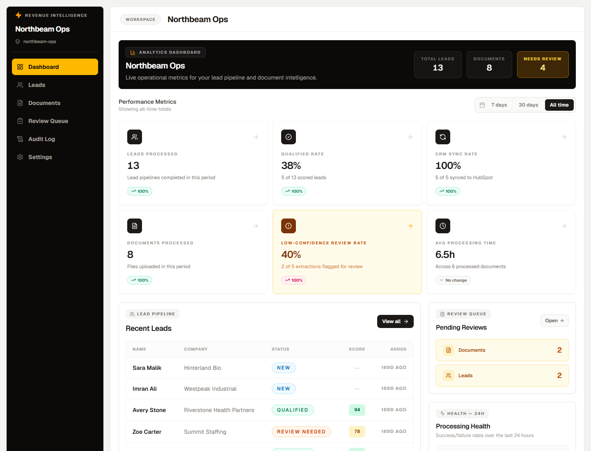
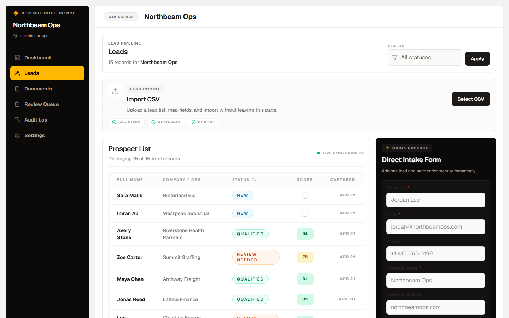
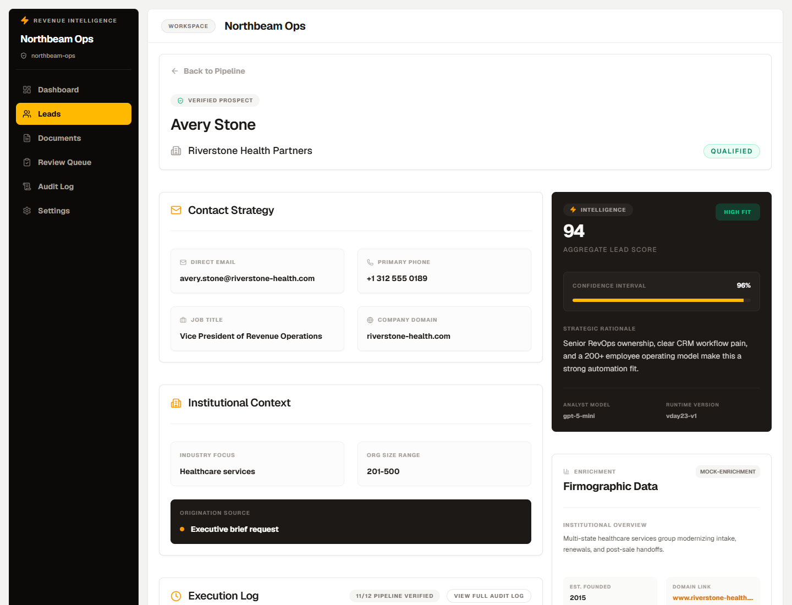
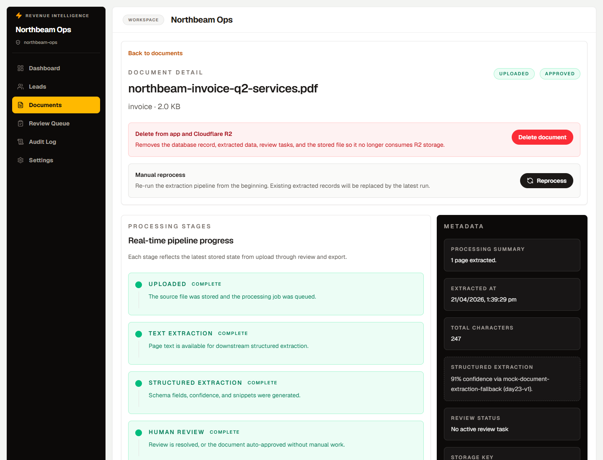
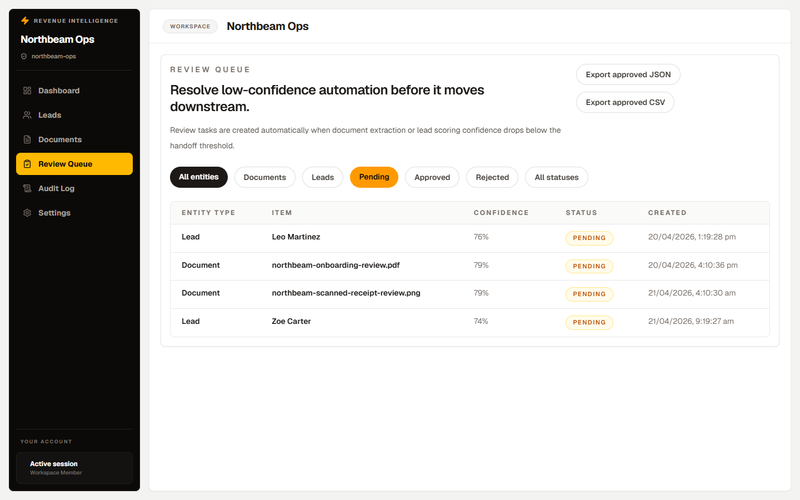

# Ops Automation Hub

    

A revenue and operations automation platform for small sales teams. Leads come in through a hosted form or CSV import, get enriched and scored by AI, are routed to a human when the model is unsure, and qualified leads are synced to HubSpot with a Slack alert. A separate Python service extracts structured data from invoices, agreements and onboarding forms, including scanned documents via OCR.

## Screenshots



| Lead pipeline | AI-scored lead |
|---|---|
|  |  |
| **Document processing** | **Review queue** |
|  |  |

## Features

**Lead pipeline**
- Hosted lead intake form and CSV import with column mapping and preview
- Background processing with Trigger.dev: enrichment, AI scoring, retry-aware audit logging
- Review queue for leads the model can't score confidently
- HubSpot contact create/update for qualified leads
- Slack notifications for qualified leads, review requests and CRM sync failures
- Sales assist: AI-generated lead summaries, follow-up email drafts and meeting briefs

**Document processing**
- Upload to Cloudflare R2, then extraction through a FastAPI service (PyMuPDF, pdfplumber, Tesseract OCR)
- Structured field extraction with per-field confidence and a human review form
- Processing stepper, retry panel and status tracking per document

**Platform**
- Clerk authentication with organization-scoped workspaces and member invites
- Activity timeline and audit log on every lead and document
- Versioned prompt templates in code so changes to AI output stay traceable

## Architecture

```
Next.js app (Clerk auth, server actions)
   │
   ├── Postgres via Prisma ── leads, documents, reviews, audit log
   │
   ├── Trigger.dev tasks
   │     ├── lead-processing   → enrich → score (OpenAI) → route → HubSpot sync
   │     ├── document-processing → Python extractor → structured fields → review
   │     └── notifications     → Slack webhooks
   │
   └── Cloudflare R2 ── uploaded documents
                          │
                          ▼
              FastAPI doc-processor (PDF text, tables, OCR)
```

More detail in [docs/architecture.md](docs/architecture.md) and the [document processor API contract](docs/python-document-processor-contract.md).

## Tech stack

| Layer | Technology |
|---|---|
| App | Next.js 16 (App Router, Turbopack), React 19, TypeScript (strict) |
| UI | Tailwind CSS 4 |
| Auth | Clerk (organizations, invites, webhooks) |
| Data | PostgreSQL (Neon) with Prisma |
| Jobs | Trigger.dev v4 |
| AI | OpenAI for scoring, extraction and sales-assist drafts |
| Documents | Python, FastAPI, PyMuPDF, pdfplumber, pytesseract, Docker |
| Storage | Cloudflare R2 (S3 API) |
| Integrations | HubSpot private app, Slack incoming webhooks |
| Quality | Vitest, ESLint, Prettier |

## Getting started

**Requirements:** Node.js 20+, PostgreSQL, a Clerk app with Organizations enabled, a Trigger.dev project and an OpenAI key. HubSpot, Slack, R2 and the Python service are only needed for those features.

```bash
npm install
cp .env.example .env.local        # every variable is described in .env.example
npm run db:generate
npm run db:migrate
npm run dev                       # http://localhost:3000

# separate terminals
npm run trigger:dev               # background jobs
docker compose -f docker-compose.doc-processor.yml up --build   # document extraction service
```

Environment templates for preview and production deployments are in `.env.preview.example` and `.env.production.example`.

### Demo data

```bash
npm run seed:demo:assets   # generates demo PDFs and images in public/demo-assets
npm run seed:demo          # "Northbeam Ops" workspace: 15 leads, 8 documents, reviews, audit history
```

The seed resets the demo workspace each time, so reruns are deterministic.

### Integrations

- **HubSpot:** create a private app with CRM contact read/write scopes, set `HUBSPOT_PRIVATE_APP_TOKEN`, then connect the workspace in Settings.
- **Slack:** set `SLACK_WEBHOOK_URL` or paste a per-workspace webhook in Settings.

Step-by-step instructions: [docs/hubspot-slack-setup.md](docs/hubspot-slack-setup.md).

## Testing

```bash
npm test            # Vitest
npm run lint
npm run typecheck
```

Sample invoices, onboarding forms and agreements for trying the document pipeline are in [docs/demo-documents/](docs/demo-documents/).

## Project structure

```
src/app/          pages and API routes
src/features/     leads, documents, review, hubspot, slack, workspaces, audit, security
src/trigger/      Trigger.dev tasks (lead processing, document processing, notifications)
src/components/   UI components
prisma/           schema and migrations
doc-processor/    FastAPI extraction service (PDF, tables, OCR) with Dockerfile
scripts/          demo seed scripts
docs/             architecture, integration setup, API contract, demo documents
```

_Developed April 2026. Imported from a private repository; the commit history was left out because it contained credentials._

## License

MIT. See [LICENSE](LICENSE).
