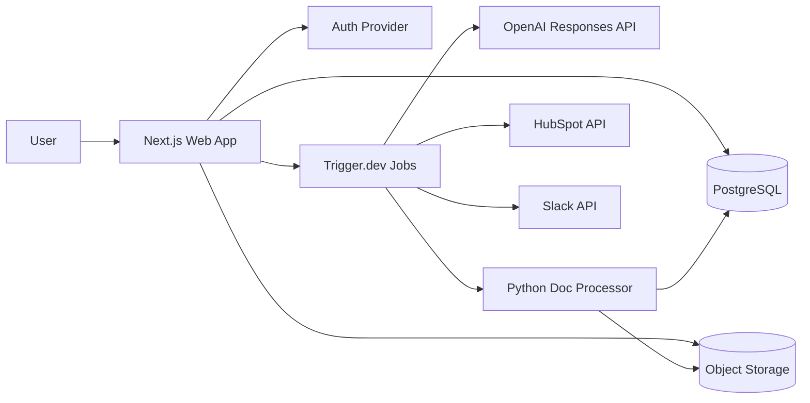

# Ops Automation Hub Architecture

## 1. Overview

Ops Automation Hub is one product with two pipelines and a shared platform layer:

- one product with two core pipelines:
  - lead intake -> enrichment -> scoring -> CRM sync -> sales assist
  - document upload -> extraction/OCR -> structured extraction -> human review -> export
- shared platform capabilities:
  - auth and workspaces
  - audit log
  - review queue
  - dashboard metrics
  - Slack alerts

Architecture style:

- modular monolith for the product app
- async job orchestration for slow or failure-prone work
- separate Python document-processing service for PDF/OCR tasks

The app stays a single deployable, and the slow or failure-prone work (enrichment, CRM sync, OCR, AI extraction) runs as retryable background jobs.

## 2. Stack

Versions as of March 2026; exact versions are pinned in the lockfile.

| Layer | Choice | Why |
| --- | --- | --- |
| Runtime | Node.js `24.x` Active LTS | Latest production LTS line; safer than Node `25.x` Current for production. |
| Web app | Next.js `16.x` | Best fit for fast full-stack delivery with App Router, route handlers, and server rendering. |
| UI | React `19.2` | Current stable React docs line, with modern primitives like `useEffectEvent`. |
| Language | TypeScript `5.9.x` | Current stable TypeScript line with strong tooling support. |
| Styling | Tailwind CSS `4.2.x` | Modern, fast, low-friction styling. |
| Auth | Clerk Organizations | Fastest reliable route for auth, invites, and workspace membership. |
| Database | PostgreSQL `18.x` | Current PostgreSQL line; strong fit for transactional SaaS data. |
| ORM | Prisma ORM `7.3.x` | Current stable Prisma line with good Next.js ergonomics. |
| Jobs | Trigger.dev `4.x` | Best fit for long-running AI/OCR jobs, retries, logs, and job visibility. |
| File storage | Cloudflare R2 or S3-compatible storage | Cheap, durable object storage for documents and previews. |
| Doc worker runtime | Python `3.13.x` | Safer than Python `3.14.x` for PDF/OCR library compatibility. |
| Doc worker API | FastAPI `0.116.x` | Lightweight, proven Python API framework for extraction services. |
| PDF extraction | PyMuPDF + pdfplumber | Good balance of speed plus layout-aware extraction. |
| OCR | Tesseract `5.4.x` | Battle-tested local OCR fallback with no per-page vendor cost. |
| AI provider | OpenAI Responses API with `gpt-5.4` and `gpt-5-mini` | Strong structured output, reasoning, and drafting support. |
| Observability | Sentry + OpenTelemetry | Error tracking first, tracing second. |
| Analytics | Postgres-backed product metrics first | Faster than introducing a separate warehouse in MVP. |
| Deployment | Vercel for web, Neon for Postgres, Trigger.dev Cloud, Railway/Fly.io for Python worker | Minimizes infra work and keeps shipping velocity high. |

## 3. High-Level System Design

## 4. Service Responsibilities

### 4.1 Next.js App

Owns:

- authentication session handling
- workspace-aware UI
- sync APIs for user actions
- settings and integration setup
- review queue UI
- dashboard and reporting views
- audit log browsing

Should not own:

- long OCR jobs
- long AI extraction jobs
- retry-heavy CRM sync orchestration

### 4.2 Trigger.dev Job Layer

Owns:

- lead enrichment jobs
- lead scoring jobs
- HubSpot sync jobs
- Slack notification jobs
- sales assist generation jobs
- document text extraction jobs
- OCR fallback jobs
- structured extraction jobs
- retry policies
- job idempotency

Key rule:

- every external side effect runs through a job, not directly from the request cycle

### 4.3 Python Document Processor

Owns:

- PDF text extraction
- OCR fallback
- page-level artifact creation if needed
- normalized extraction payload back to the app

Why separate it:

- Python PDF/OCR tooling is better than trying to force this into Node
- keeps the web app simpler
- isolates native dependencies like Tesseract

## 5. Core Domain Modules

### 5.1 Identity and Workspace

Entities:

- user
- workspace
- workspace_member
- invitation
- integration_connection

Rules:

- every business entity is workspace-scoped
- every query must filter by `workspace_id`
- no cross-workspace joins in application code without explicit admin tooling

### 5.2 Lead Operations

Entities:

- lead_source
- lead
- lead_enrichment
- lead_score
- crm_contact_sync
- sales_assist_artifact

Statuses:

- `new`
- `enriching`
- `scored`
- `review_needed`
- `qualified`
- `low_priority`
- `sync_failed`

### 5.3 Document Operations

Entities:

- document
- document_page
- extracted_record
- extracted_field
- review_task
- approval_action
- export_job

Statuses:

- `uploaded`
- `extracting_text`
- `ocr_required`
- `extracting_structured_data`
- `review_needed`
- `approved`
- `rejected`
- `exported`
- `failed`

### 5.4 Shared Platform

Entities:

- audit_log
- usage_event
- prompt_template
- prompt_run

The prompt tables matter because this product will need prompt iteration very quickly.

## 6. Data Model Guidance

Keep Prisma models grouped into these files or logical sections:

- identity and workspace
- leads
- documents
- reviews
- integrations
- audit and analytics

Implementation rules:

- use UUID primary keys
- add `workspaceId` to every tenant-owned table
- use `jsonb` for raw provider payloads and model metadata
- store enum-like states as Postgres enums where stable
- use append-only audit records for approvals and syncs

Important indexes:

- `(workspace_id, created_at desc)` on lead, document, audit_log
- `(workspace_id, status)` on lead and review_task
- unique on `(workspace_id, provider, external_id)` where relevant
- GIN on JSONB only where query patterns prove it is needed

## 7. Request And Job Flows

### 7.1 Lead Qualification Flow

1. User submits hosted form or CSV row is imported.
2. App writes a `lead` row and an audit event.
3. App enqueues `lead.enrich`.
4. Job fetches enrichment data from mock provider first, real provider second when enabled.
5. Job enqueues `lead.score`.
6. Scoring job calls OpenAI with structured output:
   - numeric score
   - fit label
   - reasoning
   - missing fields
   - confidence
7. If confidence is high and fit is high/medium, enqueue HubSpot sync.
8. Send Slack alert for qualified or review-needed leads.
9. Generate sales summary and first-pass draft artifacts asynchronously.

### 7.2 Document Processing Flow

1. User uploads file directly to object storage using presigned upload.
2. App creates `document` row.
3. App enqueues `document.extract_text`.
4. Job sends file to Python processor.
5. Python service:
   - tries direct PDF extraction
   - falls back to OCR when needed
   - returns page text, page metadata, and snippets
6. App enqueues `document.extract_structured`.
7. Structured extraction job calls OpenAI with schema-specific instructions and strict JSON schema output.
8. Validation layer checks types, required fields, and confidence thresholds.
9. If low confidence or failed validation, create `review_task`.
10. Reviewer edits fields and approves.
11. Export job creates CSV or JSON and writes audit log.

## 8. AI Design

### 8.1 Model Usage

Use the Responses API and structured outputs everywhere possible.

Recommended split:

- `gpt-5.4` for:
  - lead scoring
  - structured extraction
  - meeting brief generation
- `gpt-5-mini` for:
  - follow-up drafts
  - lead summaries
  - lightweight Slack summaries

### 8.2 Prompt Strategy

Keep prompts versioned in the database and in source control.

Required prompt families:

- lead scoring
- lead summary
- follow-up draft
- meeting brief
- invoice extraction
- onboarding form extraction
- agreement extraction

Every prompt run should store:

- prompt version
- model
- input checksum or source reference
- output JSON
- latency
- token usage
- validation result

### 8.3 Confidence Strategy

Do not trust model confidence alone.

Use combined confidence:

- model self-reported confidence
- schema validation pass/fail
- presence of required fields
- source text support
- deterministic checks:
  - email validity
  - totals and dates parse correctly
  - company domain shape

Recommended rule:

- auto-continue only when confidence >= 0.85 and validation passes
- create review task when confidence < 0.85 or critical fields fail validation

## 9. Integration Design

### 9.1 HubSpot

MVP scope:

- one workspace-level HubSpot connection
- create/update contact
- optional note creation with score summary
- show sync result and last sync time

Guardrails:

- never overwrite non-empty CRM fields with lower-confidence values
- use idempotent upsert logic keyed by email when possible
- capture full API error payload for retries and audit

### 9.2 Slack

MVP scope:

- one workspace-level Slack connection
- one configured channel
- alerts for:
  - qualified lead
  - review needed
  - CRM sync failure
  - document processing failure

Do not build:

- complex per-event routing
- per-user DM logic

## 10. Security And Tenant Isolation

MVP controls:

- tenant-aware authorization on every route
- signed uploads
- file type and size validation
- malware scan hook if available from storage or hosting provider
- secrets stored in platform secret manager only
- audit log for all approval and sync actions
- PII minimization in logs

Data handling rules:

- encrypt database and object storage at rest
- never store raw passwords in app DB if using managed auth
- redact sensitive document values from exception traces

## 11. Dashboard And Reporting

Use application DB metrics first.

Materialize these counters nightly or compute on demand with cached queries:

- leads processed
- qualified lead rate
- CRM sync success rate
- documents processed
- low-confidence review rate
- average processing time

Avoid a warehouse in MVP unless usage volume forces it.

## 12. Deployment Topology

### Production Setup

- Vercel:
  - Next.js web app
  - route handlers
  - server actions
- Neon:
  - PostgreSQL
- Trigger.dev Cloud:
  - async jobs
- Cloudflare R2:
  - document storage
- Railway or Fly.io:
  - Python document processor
- Sentry:
  - web app + worker monitoring

### Environments

- local
- preview
- production

Each environment needs isolated:

- database
- object storage bucket/prefix
- auth keys
- Slack app config
- HubSpot app config
- OpenAI keys
